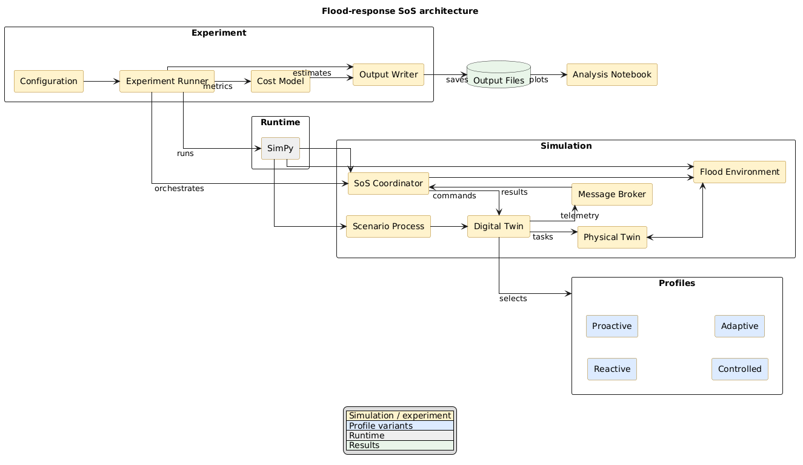

# Flood-response DT SoS simulator

This SimPy prototype compares resilience-profile strategies for a flood-response System of Systems (SoS). It models a drone, a pumping station, and a configurable fleet of equivalent boats assigned rescue or monitoring roles.

The baseline incident represents 60 simulated minutes with a one-minute decision step. SimPy advances a virtual clock, so the simulation does not wait in real time. Internal event times are seconds; reported DT participation, repair, service, and cost-driver time quantities are minutes. The baseline flood and mission-demand inputs are explicitly synthetic assumptions rather than site-calibrated measurements.

## Generated state machines

The Python state machines in `src/generated/` were autogenerated by itemis CREATE. **Do not edit these files manually.** The simulator raises events through the generated `hm` and `bm` interfaces and reads the resulting health and belonging states. Profile-specific health-to-belonging behavior remains defined by the generated machines.

## Project structure

- `src/main.py`: experiment runner, repeated simulations, aggregate and run-level outputs
- `src/run_flood_conditions.py`: separate runner for slower, baseline, and faster flood inflows
- `src/config.py`: simulation parameters, profile configuration, fleet, thresholds, and mission assumptions
- `src/coordinator.py`: mixed-profile assignment, rescue-capacity management, profile-mediated join/leave requests, task dispatch, and resource-use measurement
- `src/cost_model.py`: activity-based cost quantities, allocations, and low/base/high estimates
- `src/digital_twin.py`: generated-machine adapter, state transitions, profile changes, telemetry, and commands
- `src/environment.py`: flood dynamics, mission-target arrivals, completion deadlines, expiry, pumping, and task completion
- `src/physical_units.py`: drone, boat, and pumping-station behavior
- `src/communication.py`: in-process publish/subscribe broker with latency and message loss
- `src/scenarios.py`: connectivity scenario and DT update loop
- `src/generated/`: itemis CREATE-generated profile state machines; preserve these files unchanged
- `requirements.md`: experiment requirements
- `analysis.ipynb`: analysis notebook
- `output/`: default simulation results
- `plots/`: charts exported by the analysis notebook

## Install

Use Python 3.10 or newer. Run these commands from the `flood_sos` project directory:

```powershell
python -m pip install -r requirements.txt
```

## Run experiments

Run all three strategies with 30 repetitions each:

```powershell
python src/main.py
```

Run one strategy with all Poisson request-rate configurations, choose the number of repetitions per condition, and set a base random seed:

```powershell
python src/main.py --scenario mixed --profile-config all --runs 50 --seed 100
```

The default rescue sensitivity condition (`boat_emphasis`) uses a pump-to-rescue-area coefficient of 0.04 per hectare and rescue capacity of 3.0 mission targets per boat-minute. Run the matched 2x2 sensitivity sweep across coefficients 0.04/0.12 per hectare and boat capacities 2.0/3.0 mission targets per boat-minute with:

```powershell
python src/main.py --rescue-sensitivity all --runs 30
```

The four sensitivity identifiers are `reference`, `reduced_pump_effect`, `increased_boat_capacity`, and `boat_emphasis`. Output rows and aggregates distinguish these conditions. These factors are illustrative and require calibration before physical interpretation.

The synthetic flood model starts at 0.2 m water depth, uses a 50,000 m² base storage area that expands by 15,000 m² per metre, receives 3,500 m³/min of inflow, and allows an active pump to remove up to 300 m³/min. Storage is updated by inflow minus pump outflow; depth and flooded area follow the configured storage/area relation. The same exogenous inflow is applied across matched strategy runs, while pump availability may differ. The common mission-demand cohort contains 240 targets: 10 initially and five waves of 46 at 10-minute intervals from minute 10 through minute 50; each target has a 10-minute completion deadline.

Available strategies are `low_only`, `high_only`, and `mixed`. Profile configurations are `baseline`, `reduced_departure`, and `increased_departure`; these vary autonomous Poisson request rates. Profile membership policies independently govern which voluntary requests are accepted before an event is submitted through the generated belonging machine (`bm`). Health events enter through the generated health machine (`hm`), whose profile-specific rules determine any belonging effect. Use `--output-dir PATH` to choose a different output directory; by default, results are written to the project-root `output/` directory (`flood_sos/output/`), regardless of the current working directory. Runs with the same repetition index use the same random seed across conditions.

In the Mixed strategy, the drone becomes Proactive at the first water threshold and remains Proactive. The pumping station progresses from Reactive to Proactive and then Controlled. Operational boats progress from Reactive to Proactive to Controlled; rescue boats become Adaptive at the final threshold. Reserve boats remain Reactive while waiting, adopt the current role-specific profile when activated, and return to Reactive when placed back in reserve. Threshold values are configured in `MIXED_PROFILE_THRESHOLDS` in `src/config.py`.

## Flood-condition experiments

The current flood scenario remains the baseline. The separate runner `src/run_flood_conditions.py` compares three external inflow conditions using the existing simulator:

| Flood case | Inflow multiplier | Inflow with the current configuration |
| --- | --- | --- |
| Slower (`slower`) | 0.5x | 1,750 m³/min |
| Baseline (`baseline`) | 1x | 3,500 m³/min |
| Faster (`faster`) | 2x | 7,000 m³/min |

Multipliers apply to `flood_inflow_m3_per_minute` in `src/config.py`. They change the water volume entering the environment, rather than the simulation step or update frequency. Water depth and flooded area are still calculated by the storage-balance model, and pump operation can affect the resulting trajectory. The fleet, 240-target workload, deadlines, 60-minute horizon, profile thresholds, health-exposure rules, boat-ingress settings, and cost rates are shared across the three flood cases. With otherwise identical conditions, faster inflow can trigger health exposure and Dynamic profile escalation earlier; policy performance is determined by the simulated outcomes.

Run only the two additional cases, preserving the existing baseline files in `output/`:

```powershell
python src/run_flood_conditions.py
```

By default, each flood case covers all three policy strategies and all three departure-request-rate conditions, with 30 runs per combination under `boat_emphasis`: 270 runs per flood case, or 540 additional runs. The same base seed and repetition indices are used across cases and policies; this matches seeds, not necessarily actual event sequences.

Run all three flood cases, including a fresh baseline:

```powershell
python src/run_flood_conditions.py --flood-condition all
```

Run a selected flood case or choose experiment settings:

```powershell
python src/run_flood_conditions.py --flood-condition faster --runs 30 --seed 7
python src/run_flood_conditions.py --flood-condition slower --scenario mixed --profile-config baseline
```

The runner also accepts `--rescue-sensitivity` and `--output-dir`. Each selected flood case writes the same three result files into its own subdirectory:

```text
output/
├── slower_flood/                # 0.5x inflow
├── baseline_flood/              # 1x inflow, baseline
└── faster_flood/                # 2x inflow
```

Within each case directory, `simulation_summary.json` records the flood case, multiplier, and baseline inflow in the experiment configuration, and the case and multiplier in each run record. The run CSV already includes the actual inflow. Aggregate keys retain their existing policy/request-rate/sensitivity format because flood cases are stored separately. Repeating a case overwrites that case's result files; `--output-dir` can select a different output root.

The runner temporarily updates the shared simulation configuration and restores it even if execution fails. It does not edit `config.py`, the generated state machines, or the ordinary `main.py` experiment. The current notebook continues to read the baseline files in `output/`; selecting and comparing the new case directories is a separate analysis change.

## Outputs

- `output/simulation_summary.json`: experiment parameters, aggregates by strategy/profile/rescue-sensitivity condition, run-level outcomes, state transitions, and coordinator events
- `output/simulation_runs.csv`: one row per run with mission outcomes and resource-use metrics
- `output/flood_history.csv`: time-series flood and mission target data for every run

Mission success is an outcome: the run succeeds only if the configured mission-objective target is achieved before the applicable deadlines. It is not determined by the assigned profile. In this flood scenario, objective achievement is measured by mission targets completed before their individual deadlines. Outputs include run-level outcomes, success rates, autonomous request outcomes, attached and Active DT-time, pumping-station active/service time and output, health-recovery readmission outcomes, activity quantities, and cost estimates by activity and category.

The cost pipeline uses activity-based costing adapted to this flood-response scenario. It maps data gathering, interaction, storage, processing, servitization, maintenance, and reserve-boat deployment to explicit activity drivers, then reports low/base/high estimates across IT infrastructure, resources, data activities, and investment. Repair cost grows with repair time; backup cost grows with deployed rescue time. Shared CapEx is amortized over the configured mission count; OpEx grows with mission duration. Rates in `config.py` are illustrative placeholder cost units, not market prices or values copied from the manufacturing study. Calibrate and source them before making monetary claims. DT-time remains a separate utilization metric.

The Poisson rates, membership policy, flood thresholds, boat throughput, target-completion deadline, success target, cost drivers, and cost rates are experiment assumptions in `src/config.py`; calibrate and justify them before reporting research results.

## Simulator architecture

[](docs/architecture.pdf)
 

The experiment runner loads the configuration and executes the simulation using SimPy. The coordinator assigns profiles and manages participation and mission tasks. Each digital twin connects a physical unit to a generated resilience-profile state machine, which governs its health and belonging transitions. The flood environment and scenario processes provide operational conditions and disturbances, while the message broker carries telemetry and task results. Recorded activity quantities feed the ABC cost model, and the resulting traces and metrics support the analysis notebook.
